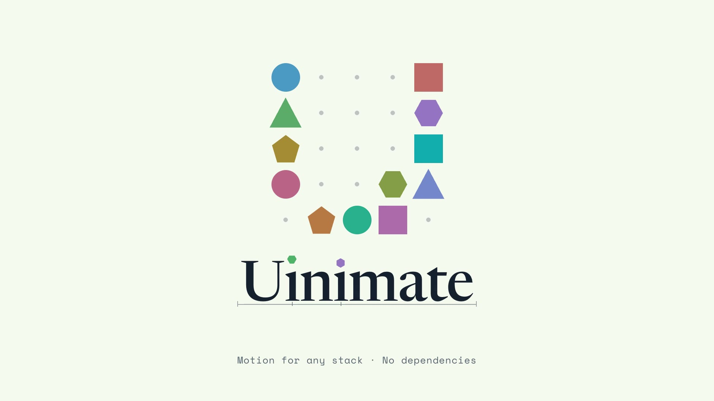

<p align="center">
  
</p>

# Uinimate

**A laboratory of animated UI components.** Pure CSS and SVG motion for any stack. No dependencies. Tune every animation before you copy it.

`[ 0 deps ]` `[ CSS · SVG ]` `[ any framework ]`

> Pronounced "you-eye-nimate". Early days: the first components are in, many more are on the bench.

## Components

| No. | Name | What it does |
|---|---|---|
| U-001 | [Burger](packages/core/src/components/burger) | Three lines meet, then become a cross, arrow, minus, plus or a twisting cross |
| U-002 | [Theme toggle](packages/core/src/components/theme-toggle) | Sun to moon: rays pull in, the moon draws in. Six variants |
| U-003 | [Disclosure](packages/core/src/components/disclosure) | Collapsible sections that open to their natural height. Stackable |

## Use

```html
<link rel="stylesheet" href="uinimate/components/burger/burger.css" />
<button class="u-burger" aria-expanded="false" aria-label="Menu">…</button>
```

Your code flips `aria-expanded`; the CSS animates it. Tune with custom properties:

```css
.site-header { --u-burger-duration: 500ms; --u-icon-cap: round; }
```

Works in React, Vue, Svelte, Astro, plain HTML, Webflow and Shopify. If it renders HTML, it runs Uinimate.

## Principles

1. **Zero dependencies.** Pure CSS and SVG. Nothing to install, no runtime.
2. **Works everywhere.** One animation, every framework.
3. **Make it yours.** Speed, easing, colour and intensity are all tunable.
4. **Motion with manners.** Reduced-motion aware, no layout shift, small.
5. **Craft over quantity.** Fewer, better specimens.

## Repo

```
packages/core   the library (npm: uinimate)
apps/site       the website (Astro)
brand           brand kit and brand film
skills          agent skills (brand guidelines for AI tools)
```

```bash
pnpm install
pnpm dev                      # http://localhost:4321
pnpm new <slug> "<Name>"     # scaffold a component that follows the contract
pnpm check                    # validate every component
```

How components are built: [`skills/uinimate-components/SKILL.md`](skills/uinimate-components/SKILL.md).

## Use it with an AI agent

Copy [`skills/uinimate`](skills/uinimate) into your agent's skills folder (for Claude Code: `.claude/skills/uinimate`) and ask for "an animated burger menu", "a dark-mode toggle" or "an FAQ accordion". The skill tells the agent how to fetch, wire and tune the components in your framework.

## Brand

The brand guide lives in [`brand/brand-guide.html`](brand/brand-guide.html), and the full guidelines for people and AI tools in [`skills/uinimate-brand/SKILL.md`](skills/uinimate-brand/SKILL.md).
